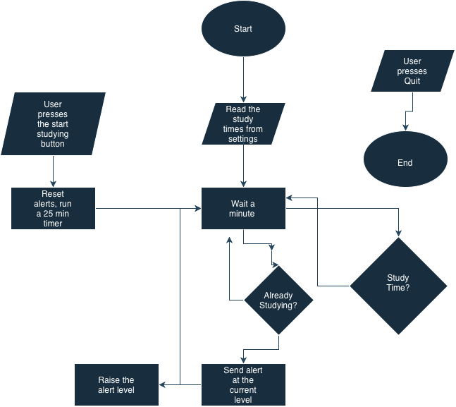

# Study Alert

A Java desktop app for macOS that nags me, more and more annoyingly, to study during my scheduled study times.

## The Problem

I lose too much time to social media when I should be studying, and normal reminders are too easy to ignore. I built this app to make study time impossible to miss: it keeps escalating its alerts until I actually start a study session.

## How It Works

- **Study schedule:** reads study times from a settings file
- **Background check:** every minute, checks whether it's study time and whether a session has started
- **Escalating alerts:** each ignored alert gets worse, from a banner notification to an alarm sound to a pop-up to a spoken voice, repeating until I respond
- **Start studying:** silences all alerts, resets the alert level, and starts a 25-minute timer
- **Rechecking:** when the timer ends, the app goes back to checking and alerts again if I'm still in a study block
- **Quit:** closes the app at any time



## Tech Stack

- **Language:** Java (JDK 21+)
- **Libraries:** Swing (built into Java), JUnit 5 for testing
- **External tools:** Maven, IntelliJ IDEA, macOS commands (`osascript`, `say`, `afplay`), launchd

## Setup

Requires macOS and JDK 21 or newer.

```bash
git clone https://github.com/sanyog08/study-alert
cd study-alert
```

Build steps will be added once the first milestone is complete.

## Usage

The app is in the planning stage. Run instructions will be added once the first working version is built.

## Planning

### Eisenhower Matrix

| | Urgent | Not Urgent |
|---|---|---|
| **Important** | MacAlerts class<br>Study time check with escalation<br>Start studying button that stops alerts and runs a timer | Social media detection<br>Full-screen nag with an escape hatch<br>Auto-start when the user logs in |
| **Not Important** | Use built-in macOS audio<br>Edit settings in a file, not a settings screen<br>Have IntelliJ generate the Maven project | Fancy UI and themes<br>Website blocking using the hosts file<br>iPhone app, sync across devices |

### Build Plan

1. Project setup
2. Mac alert helper
3. Study timer
4. Study schedule
5. Escalation
6. Full-screen alert
7. Social media detection
8. Stats
9. Auto-start

## Roadmap

- [ ] Social media detection
- [ ] Full-screen nag with an escape hatch
- [ ] Auto-start at login

## Author

[sanyog08 on GitHub](https://github.com/sanyog08)
